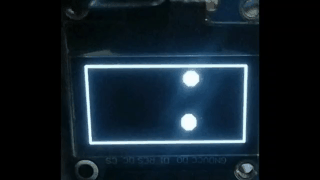

<h1 align="center">OledDisplay</h1>
<p align="center">
  
</p>


<p align="center">
  A lightweight Arduino library for <b>SSD1306 128x64 OLED</b> displays with <b>I2C</b> and <b>SPI</b> support.
</p>

<p align="center">
  
  
  
</p>

---

## Overview

OledDisplay keeps a framebuffer in RAM and exposes a small, easy-to-use drawing API. You draw into the buffer, then call `update()` to push it to the screen. The same API works over **I2C** or **SPI** - only the constructor changes.

## Features

- I2C and SPI transports behind one common base class
- Pixels, lines, rectangles, circles and triangles (outline and filled)
- Bitmap drawing
- Built-in 6x8 text font
- Hardware scrolling (left / right)
- Contrast control, hardware and software inversion, display power on/off
- Bounds-checked drawing (off-screen pixels are safely ignored)
- Four ready-to-run examples

## Repository Structure

```
OledDisplay/
├── src/
│   ├── OledDisplay.h / .cpp          Base class and drawing API
│   ├── OledDisplay_SPI.h / .cpp      SPI transport
│   ├── OledDisplay_I2C.h / .cpp      I2C transport
│   ├── OledDisplay_Init.h            SSD1306 init sequence
│   └── fonts/
│       └── Font6x8.h                 6x8 font data
├── examples/
│   ├── BasicShapes/
│   ├── TextDisplay/
│   ├── Animation/
│   └── GraphicsDemo/
├── docs/
│   └── demo.gif                      
├── library.properties
├── keywords.txt
├── LICENSE
└── README.md
```

## Hardware

- Any SSD1306-based 128x64 OLED (I2C or SPI version)
- ESP32 (default pins below) or another Arduino-compatible board

### Wiring - I2C (defaults)

| OLED | ESP32 |
|------|-------|
| VCC  | 3.3V  |
| GND  | GND   |
| SDA  | GPIO 21 |
| SCL  | GPIO 22 |

### Wiring - SPI (defaults)

| OLED | ESP32 |
|------|-------|
| VCC  | 3.3V  |
| GND  | GND   |
| SCK (D0) | GPIO 18 |
| MOSI (D1) | GPIO 23 |
| CS   | GPIO 14 |
| DC   | GPIO 27 |
| RES  | GPIO 16 |

All pins can be changed through the constructor.

## Installation

**Arduino IDE (ZIP)**
1. Download this repository as a ZIP (**Code > Download ZIP**).
2. In the Arduino IDE: **Sketch > Include Library > Add .ZIP Library...**
3. Select the downloaded file.

**Manual**
1. Clone or copy the `OledDisplay` folder into your Arduino `libraries/` directory.
2. Restart the Arduino IDE.

## Quick Start

### I2C

```cpp
#include <OledDisplay_I2C.h>

// width, height, SDA, SCL, reset (-1 if unused), I2C address
OledDisplay_I2C display(128, 64, 21, 22, -1, 0x3C);

void setup() {
  display.begin();
  display.clearDisplay();

  display.drawString("HELLO, WORLD!", 0, 0);
  display.drawCircle(64, 40, 12, 1, true);

  display.update();   // push the framebuffer to the screen
}

void loop() {}
```

### SPI

```cpp
#include <OledDisplay_SPI.h>

// width, height, SCK, MOSI, CS, DC, RESET
OledDisplay_SPI display(128, 64, 18, 23, 14, 27, 16);
```

Everything else (`begin()`, drawing calls, `update()`) is identical.

## API Reference

Colors: `1` = pixel on, `0` = pixel off. Drawing functions write to the framebuffer; call `update()` to show the result. Most functions accept an optional `immediateUpdate` argument (default `false`).

### Screen

| Method | Description |
|--------|-------------|
| `begin()` | Initialize the bus and the display |
| `update()` | Send the framebuffer to the display |
| `clearDisplay()` | Clear the framebuffer and update the screen |
| `fillBuffer(pattern)` | Fill the framebuffer with a byte pattern (`0x00` clears it without updating) |
| `setPower(on)` | Turn the display on or off |
| `setContrast(level)` | Set contrast, 0-255 |

### Drawing

| Method | Description |
|--------|-------------|
| `drawPixel(x, y, color)` | Single pixel |
| `drawLine(x0, y0, x1, y1, color)` | Line between two points |
| `drawHorizontalLine(x1, x2, y, color)` | Horizontal line |
| `drawVerticalLine(x, y1, y2, color)` | Vertical line |
| `drawRectangle(x, y, w, h, color, filled)` | Rectangle |
| `drawCircle(xc, yc, r, color, filled)` | Circle |
| `drawTriangle(x1, y1, x2, y2, x3, y3, color, filled)` | Triangle |
| `drawBitmap(x, y, bitmap, w, h)` | Bitmap (page-major: 1 byte = 8 vertical pixels, bit 0 = top) |

### Text

| Method | Description |
|--------|-------------|
| `drawChar(c, x, y)` | Single 6x8 character |
| `drawString(text, x, y)` | String, 6 pixels per character |

The built-in font covers ASCII `0x20`-`0x60`. Lowercase letters are rendered as uppercase.

### Effects

| Method | Description |
|--------|-------------|
| `invertBuffer()` | Invert the framebuffer contents |
| `invertDisplayHardware(enable)` | Invert the display using the controller |
| `startScrolling(direction, startPage, endPage, speed)` | Start hardware scrolling (`SCROLL_LEFT` / `SCROLL_RIGHT`) |
| `stopScrolling()` | Stop scrolling |

Valid scroll speeds (frames per step): `2, 3, 4, 5, 25, 64, 128, 256`.

## Examples

| Example | What it shows |
|---------|---------------|
| **BasicShapes** | Lines, rectangles, circles and triangles |
| **TextDisplay** | Text rendering and hardware scrolling |
| **Animation** | A bouncing ball drawn from the framebuffer |
| **GraphicsDemo** | Bitmap, contrast sweep, inversion and power control |

Open them from **File > Examples > OledDisplay** in the Arduino IDE.

## ESP32 vs Arduino (AVR) Differences

The library uses the same API on both, but a few implementation details differ. The library was developed and tested on **ESP32**; the AVR notes below come from the code and board specs and have not been tested on hardware.

| Area | ESP32 | Arduino Uno / Nano (AVR) |
|------|-------|--------------------------|
| **I2C pins** | Any GPIO. `Wire.begin(sda, scl)` uses the pins you pass (default 21 / 22) | Fixed: SDA = A4, SCL = A5. `Wire.begin()` is called and the `sda` / `scl` arguments are ignored |
| **SPI pins** | `SPI.begin(sck, -1, mosi, -1)` uses the pins you pass (default 18 / 23) | Fixed: SCK = 13, MOSI = 11. `SPI.begin()` is called and the `sck` / `mosi` arguments are ignored |
| **CS / DC / RESET** | Any GPIO (defaults 14 / 27 / 16) | Any digital pin, but the ESP32 defaults do not suit an Uno, so always pass your own (for example CS 10, DC 9, RESET 8) |
| **Logic level** | 3.3 V | 5 V (Uno / Nano). Many OLED modules accept 3.3-5 V on VCC, but check your module's datasheet |
| **RAM** | ~320 KB. The 1 KB framebuffer is negligible | 2 KB on an Uno / Nano. The 1 KB framebuffer takes half of it, leaving little for your sketch. Boards like the Mega (8 KB) are more comfortable |
| **PROGMEM** | A no-op, since flash is memory-mapped. `memcpy_P` behaves like `memcpy` | Required. Flash data must be read with `memcpy_P` / `pgm_read_*`, which the library does for the font and init sequence |
| **Speed** | Fast CPU (240 MHz) and fast SPI. Raising `clockSpeed` to 8-10 MHz is possible | 16 MHz CPU. Full-screen updates are noticeably slower, especially over I2C |
| **I2C chunking** | Library sends 31 data bytes per transmission | Same. The AVR Wire buffer is 32 bytes (1 control byte + 31 data), which is why the chunk size is 31 |

### Where the difference lives in the code

Only the `begin()` functions change, using a compile-time check:

```cpp
// OledDisplay_I2C::begin()
#if defined(ESP32)
    Wire.begin(sda, scl);   // custom pins
#else
    Wire.begin();           // fixed hardware pins
#endif

// OledDisplay_SPI::begin()
#if defined(ESP32)
    SPI.begin(sckPin, -1, mosiPin, -1);   // custom pins
#else
    SPI.begin();                          // fixed hardware pins
#endif
```

Drawing code, the framebuffer and the SSD1306 commands are identical on both platforms.

### Example: Arduino Uno

```cpp
// I2C - SDA = A4, SCL = A5 (fixed). Pin arguments are ignored on AVR.
#include <OledDisplay_I2C.h>
OledDisplay_I2C display(128, 64, 0, 0, -1, 0x3C);

// SPI - SCK = 13, MOSI = 11 (fixed). Set CS, DC and RESET yourself.
// #include <OledDisplay_SPI.h>
// OledDisplay_SPI display(128, 64, 13, 11, 10, 9, 8);
```

## Notes

- Framebuffer size is `width * height / 8` bytes (1 KB for 128x64).
- Pass `-1` as the reset pin if your module has no reset line.
- Developed and tested on ESP32. Arduino Uno / Nano should compile, but RAM is tight (see the section above).
- Default I2C address is `0x3C`; some modules use `0x3D`.

## Contributing

Issues and pull requests are welcome. If you find a bug or want a new feature (more fonts, other resolutions, extra shapes), open an issue with a short description.

## License

Released under the [MIT License](LICENSE).
